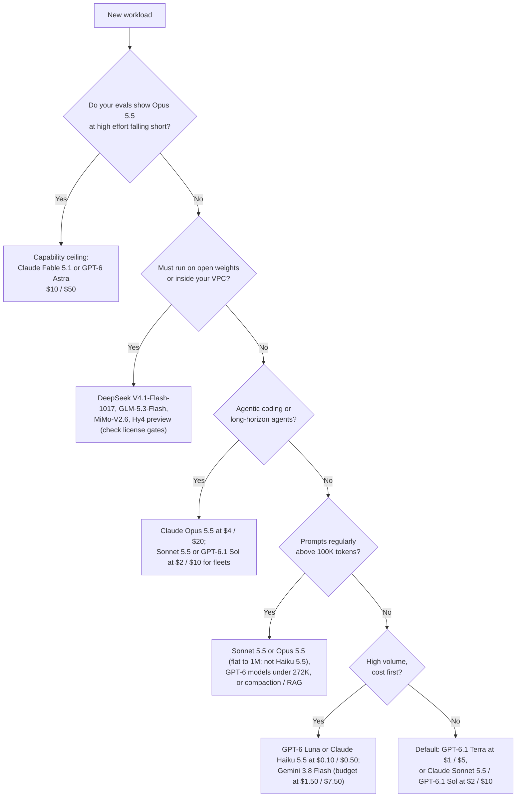

# Model Selection Guide

A practical framework for choosing the right LLM for your use case, considering capability, cost, latency, and operational factors.

## Table of Contents

- [Selection Framework](#selection-framework)
- [Capability Comparison](#capability-comparison)
- [Use Case Mapping](#use-case-mapping)
- [Cost Analysis](#cost-analysis)
- [Operational Considerations](#operational-considerations)
- [Multi-Model Strategies](#multi-model-strategies)
- [Interview Questions](#interview-questions)
- [References](#references)

---

## Selection Framework

### Decision Tree (November 2026)



Two things changed the tree in September 2026. Anthropic now tells customers to start with **Opus 5.5**, which costs 40% of Fable 5.1 and beats it on the agentic and coding benchmarks in Anthropic's own launch table (vendor-reported), so the ceiling tier is an escalation path, not a starting point. And the $2 / $10 mid tier (Sonnet 5.5, GPT-6 Sol, GPT-6.1 Sol) lands close enough to the flagships on vendor-reported agentic evals that most agent traffic may not need Opus-class pricing; confirm that on your own tasks before moving the fleet.

October changed it again. GPT-6.1 Terra ($1 / $5) and Claude Haiku 5.5 ($0.10 / $0.50) filled the middle and fast rungs, so both vendors now offer three price tiers. And the long-prompt branch moved from 272K to 100K: Haiku 5.5 bills the whole request at 5x once the prompt, cached tokens included, passes 100,000 tokens, so the cheapest Anthropic model is the wrong choice for exactly the long-context work where Anthropic's other models carry no surcharge.

### Key Selection Factors

| Factor | Weight | Considerations |
|--------|--------|----------------|
| **Agentic Reliability** | High | Tool-calling accuracy, multi-step planning, binary task completion |
| **Cost per Task** | High | Tokens per task × price, not price per token. Agentic loops consume 5x-10x more tokens, and models differ several-fold in tokens per task |
| **Context Recall and Pricing** | High | Recall at 1M, and whether the vendor bills a long-context cliff (Claude Haiku 5.5 above 100K at 5x, OpenAI above 272K, xAI at 200K) |
| **Rate Limit Ceiling** | High | **(Principal Nuance)**: Can the provider handle your P99 throughput without 429 errors, and will a monthly spend cap hard-stop traffic? |
| **Data Handling** | High | ZDR availability (yes on Opus 5.5 and Sonnet 5.5; Fable 5.1 only if expressly authorized; none on the OpenAI Agents API) and the ~10% residency premium |
| **Ecosystem Maturity** | High | Production track record, SDK support, and Enterprise SLA. SDK majors can change the API contract: Anthropic's new SDKs send API version `2026-10-21`, which rejects sampling parameters on every model |
| **Lifecycle Runway** | Medium | Retirement floor and notice period per platform (Opus 5.5, Sonnet 5.5, Fable 5.1: not before September 2027; Haiku 5.5: not before October 7, 2027), and whether the vendor honors its stated notice (OpenAI gave its GA GPT-4o and GPT-4.1 snapshots about 3 months) |

---

## Capability Comparison

### Frontier Model Comparison (November 2026)

Scores below are labeled by source. "AA" is the Artificial Analysis Intelligence Index v5.0, announced October 27 (Claude Opus, Sonnet and Fable entries are "with fallback"), except where v5.0.1 is noted: AA's November 3 methodology update regraded every model on CritPt v2 and moved Opus 5.5 to 59 and Gemini 4 Carbon to 60. v4.x scores are on a different scale and are not comparable. Scores are at max effort unless noted.

| Model | Strengths | Cons | Context | Best For |
|-------|-----------|------|---------|----------|
| **Claude Opus 5.5** ($4 / $20) | Anthropic's recommended default. AA v5.0.1 59 (58 on v5.0), the top score among models developers can call (the gated Gemini 4 Carbon scores 60). Beat Fable 5.1 on every row of Anthropic's launch table and GPT-6 Astra on most (Terminal-Bench 4.0 66.4% at xhigh vs 57.9%), though Astra led on AutomationBench (41.4% vs 40.0%) and Terminal-Bench-Science (64.6% vs 58.7%); all vendor-reported. Independently, first on the Terminal-Bench 4.0 leaderboard (64.85%, max; tbench.ai, entries added October 6). 0.05x cache reads; fast mode ($8 / $40) out of research preview since October 15; ZDR available | Default effort dropped to `medium`; thinking cannot be disabled; forced `tool_choice` returns 400; headline scores include safeguard fallback to Opus 4.8 or Opus 5 | 1M / 128K out | Agentic coding, computer use, hard production work |
| **Claude Sonnet 5.5** ($2 / $10) | Within a few points of Opus 5.5 on Anthropic's agentic evals (vendor-reported Terminal-Bench 4.0 70.6%, OSWorld 2.1 80.1% partial). Second on the Terminal-Bench 4.0 leaderboard (61.82%, max). AA 54. Cache reads cut to 0.05x ($0.10) on October 7. ZDR available | Independent gap to Opus widens at lower effort (AA 41 at high vs Opus 5.5's 52); `thinking: disabled` returns 400; thinking blocks are bound to the producing account | 1M / 128K | Agent fleets, coding at scale, default chat |
| **Claude Fable 5.1** ($10 / $50) | Anthropic's ceiling. Flat $10 / $50 to 1M with 0.025x cache reads. Terminal-Bench 4.0 leaderboard 57.88% (max) | Opus 5.5 beats it on Anthropic's own tables at 40% of the price; AA 50 at xhigh, 8 below Opus 5.5; 30-day retention, ZDR only if authorized | 1M / 128K | Tasks where Opus 5.5 at higher effort still fails your evals |
| **GPT-6 Astra** ($10 / $50) | OpenAI's ceiling. Terminal-Bench 4.0 leaderboard 58.18% (max), tied with GPT-6.1 Sol behind Opus 5.5 and Sonnet 5.5. About a third of GPT-5.6 Sol's tokens per coding task (AA). AA 57 | Whole request at $20 / $75 above 272K; no temperature, top_p, logprobs or `none` effort; first OpenAI model rated Critical for cyber, so exploit work is restricted outside Daybreak | 1.05M / 128K | Ceiling work on the OpenAI stack; long coding tasks where token efficiency offsets price. Cyber work beyond Astra's limits goes to the gated GPT-6-Cyber ($20 / $100) |
| **GPT-6.1 Sol** ($2 / $10) | AA 55, 2 behind Astra at a fifth of the price, and tied with Astra at 58.18% on the Terminal-Bench 4.0 leaderboard. 0.05x cache reads. Codex CLI's default. Ultrafast ($12 / $60) for all API users since October 8 | 272K cliff; default effort `medium` | 1.05M / 128K | OpenAI-side default for coding and professional work |
| **GPT-6.1 Terra** ($1 / $5) | AA 51, 3 behind Sonnet 5.5 at half its price. 0.05x cache reads; `none` effort for latency-sensitive paths; also on Bedrock | Released October 26, so independent evaluation beyond AA is thin; AA 38 at the default `medium`, so the headline score costs max-effort tokens; rated Critical for cyber; 272K cliff | 1.05M | The OpenAI middle tier: agent fleets and general production that do not need Sol |
| **GPT-6 Sol / GPT-6 Luna** ($2 / $10; $0.10 / $0.50) | Half the GPT-5.6 prices; Luna resets OpenAI's floor (AA 28) | Image understanding was degraded until a September 25 fix shipped under the same IDs; GPT-6.1 Sol has the same price with cheaper cache reads | 1.05M / 128K | Sol: existing integrations. Luna: routing, classification, extraction |
| **Gemini 4 Argon** ($2 / $10 through Nov 30; $4 / $20 from Dec 1) | GA October 13. Text, image, video, audio and PDF in; computer use; output up to about 1M through long decode. AA 50 (high) | Price doubles December 1, to Opus 5.5's list price at 8 fewer AA points; implicit caching only; 65,536 default output; paid tier only | 1M shared in and out | Multimodal-heavy and long-generation work on the Google stack |
| **Gemini 3.8 Flash** ($0.75 / $3.75 intro; $1.50 / $7.50 from Jan 1, 2027) | Ties GPT-6 Astra and Opus 5 at 74% on DeepSWE v1.1 at the lowest cost per task ($2.36). Google's recommended model for Gemini computer use (the Computer Use tool went GA October 30) | Price doubles January 1; spends more reasoning tokens per task; AA 31 (high); 65,536-token output cap | 1M / 65K | Cost-per-task leader for coding agents; high-volume RAG |
| **Grok 4.7** ($2 / $6) | Cheapest output among $2-input models; new, larger base model | Whole request doubles at 200K; AA 35 (high), about 20 points under the $2 / $10 models; fast variant only in Cursor and Grok Build | 500K | Output-heavy work under 200K |
| **Muse Wonder** ($4 / $20) | Meta's new closed flagship (October 12) on the Meta Model API; 1M context; computer use across browsers, desktop and mobile apps (Meta's description). AA 43 | Opus 5.5's list price at 15 fewer AA points; no benchmark numbers from Meta at launch; the stronger Muse Wonder Full (AA 50) is sold only inside Muse Code subscriptions, so your API evals measure the lesser model | 1M | Teams already on Meta's stack, after a head-to-head eval against Opus 5.5 |
| **Muse Spark 1.3** ($1.25 / $4.25) | Priced well under the $2 / $10 tier (not yet scored on AA v5.0) | More verbose than 1.2, so cost per task rose; the contributor tier trades your data for price | 1M | Price-sensitive general work, after a cost-per-task check |

**Superseded but still served:** Claude Opus 5, Sonnet 5, Fable 5, Opus 4.8 and Haiku 4.5; GPT-5.6 Sol, Terra and Luna; GPT-5.5. Claude Sonnet 4.5 retires November 30, 2026 on the Claude API (April 8, 2027 on Bedrock), and requests to `gemini-3.7-flash` are already served by 3.8 Flash.

**Gated or announced, not callable by most developers (as of November 6, 2026):** Google's **Gemini 4 Carbon** (announced October 28) is limited to a subset of cyber defenders in the Fairwind Program, with no model ID, yet it tops AA v5.0.1 at 60. **GPT-6 Rosalind** (October 30, $15 / $75), **GPT-6-Cyber** (November 5, $20 / $100, Daybreak Red plus a separate model approval and IP allowlisting) and **Claude Mythos 5.1** are trusted-access only. Do not plan around any of them. Both models that were announced-not-shipped a month ago are now GA: Gemini 4 Argon (October 13) and Claude Haiku 5.5 (October 7).

### Budget Model Comparison

| Model | Cost (per 1M input/output) | Quality Signal | Context | Best For |
|-------|----------------------------|----------------|---------|----------|
| **GPT-6 Luna** | $0.10 / $0.50 ($0.20 / $0.75 above 272K) | AA 28; successor to GPT-5.6 Luna at half the price | 1.05M | Routing, classification, extraction; also the Decisions API model |
| **Claude Haiku 5.5** | $0.10 / $0.50 up to a 100K-token prompt; $0.50 / $2.50 on the whole request above | AA 36; Terminal-Bench 4.0 39.2% (Anthropic) | 1M | Anthropic-stack fast tier for short prompts; route anything near 100K tokens elsewhere |
| **GPT-6.1 Terra** | $1.00 / $5.00 | AA 51 at max, 38 at `medium` | 1.05M | The step up from Luna before paying for Sol |
| **Gemini 3.8 Flash** | $0.75 / $3.75 intro; $1.50 / $7.50 from Jan 1, 2027 | DeepSWE v1.1 74% (three-way tie); AA 31 (high) | 1M | Coding agents, RAG |
| **DeepSeek V4.1-Flash** | $0.30 / $1.20 peak; half off-peak | AA v5.0.1 33 at max, 29 at high (1017 build) | 1M | Batch work scheduled off-peak (weekends are entirely off-peak) |
| **GLM-5.3-Flash** | $0.15 / $0.50 | AA 28 | 1M | MIT weights: same model by API or self-hosted |
| **MiMo-V2.6-Flash** | $0.14 / $0.28 (OpenRouter) | - | 1M | MIT, 309B / 15B active; fits one 8-GPU node when you outgrow the API |
| **Claude Haiku 4.5** | $1.00 / $5.00 | Superseded; 10x Haiku 5.5's price below 100K | 200K | Only where prefill or `budget_tokens` code cannot move yet; Foundry lists it for retirement November 15 |

### Open-Weight Models

| Model | Parameters | License | AA (v5.0.1 where marked) | Best For |
|-------|------------|---------|--------------------------|----------|
| **Moonshot Kimi K3.1 Pro** | 2.8T / 104B active | Kimi K3.1-Pro License (MIT-like grant; separate deal for MaaS above US$20M revenue; UI credit above 100M MAU) | 46 (v5.0.1; AA still labels it proprietary) | Top open score since its weights shipped November 4; $2 / $10 hosted by Moonshot; about 1.56 TB of MXFP4 weights to serve yourself |
| **DeepSeek V4.1-Flash-1017** | 552B (763B checkpoint); 8B / 16B active | MIT | 33 (v5.0.1, max); 29 at high | Top MIT score; cheap 1M-context serving |
| **Z.ai GLM-5.3** | 744B / 40B active | MIT plus security review for MaaS operators above US$10B revenue | 32 (v5.0.1, max); 23 at low | Agentic coding; also on Amazon Bedrock |
| **Xiaomi MiMo-V2.6-Pro** | 1.02T / 42B active | MIT | 30 (v5.0.1) | Omni-modal input; two 8-GPU nodes |
| **Ant Group Ling-3.1-flash-1019** | 560B / ~25B active | MIT | 30 (v5.0.1) | Very verbose (240M output tokens on the index vs a 99.3M median): price per task |
| **StepFun Step 5 Preview** | 600B / 27B active | StepFun Model License 1.0 (separate deal for MaaS above US$20M revenue and for any branded device) | 29 | Verbose; check tokens per task |
| **Z.ai GLM-5.3-Flash** | 320B / 18B active | MIT | 28 | Default self-host candidate for agentic coding |
| **Mistral Large 4** | ~1T / 49B active | Mistral Ecosystem Open-Weight License (separate license for any MaaS business) | 26 at High (default), 23 at Medium | Internal self-hosting; not for resale without a deal. Reasoning modes are Low, Medium and High, so preview code asking for no reasoning must send low |
| **Meta Muse Spark Open** | 816B / 42B active | Muse Model License (attribution; separate deal for MaaS above US$20M revenue) | 25 (v5.0.1) | Top US open-weight model; text, image, video and audio in. Also hosted on Fireworks at $1.25 / $4.25, Muse Spark 1.3's price, so pick on license and data terms; the Hugging Face repo needs manual approval |
| **Moonshot Kimi K3** | 2.8T / 104B active | Custom: separate deal for MaaS above US$20M revenue | - | Strong generalist if the license fits; on Amazon Bedrock with explicit prompt caching |
| **Qwen3.8-Flash-Next** | 125B / 6B active + 51B N-gram memory | Qwen Community 1.0 (separate license for any MaaS or coding/office-assistant business) | - | Qwen4 architecture preview; host-RAM parameter memory. Qwen4 itself had not shipped as of November 6, so do not plan around its weights or license |
| **Tencent Hy4 preview** | 770B / 49B active | Apache 2.0 (preview checkpoint only) | - | Cleanest license at frontier-adjacent scale. The full Hy4 (November 4, AA v5.0.1 35) is API-only, with weights promised but no date or license, so do not assume Apache 2.0 for it |
| **Qwen3.8-27B** | 27B dense | Apache 2.0 | 20 (v5.0.1, xhigh) | Single-GPU class |
| **Nanbeige4.3-33B** | 33B dense | Apache 2.0 | 20 (v5.0.1) | Single-GPU peer to Qwen3.8-27B at higher cost per task (160M output tokens vs a 77.7M median); no public API |
| **Reflection AI Beam 1.0** | 501B / 23B active | Apache 2.0 | 18 (v5.0.1) | Unconditional US-origin Apache license at 500B scale; a provenance pick, not a capability pick |
| **Ricursive Ripple-65B Preview** | 65B dense | Apache 2.0 | - (not yet scored) | Vendor-reported Terminal-Bench 2.1 80.52; wait for an independent score |
| **Inkling-Small** | ~266B / 12B active | Apache 2.0 | 13 | US-origin, Apache, fine-tuning base |
| **NVIDIA Nemotron 3.5 Super VL** | 120B / 12B active | OpenMDW-1.1 | 14 | NVIDIA-stack open agents; replaces Nemotron 3 Ultra (12) as the default, with image and video input, on four H100s |

Check the license before the benchmark. Several leading open models now carry revenue-gated commercial terms aimed at Model-as-a-Service resellers, Mistral Large 4 requires a separate license for any MaaS business at any revenue, and Mistral Medium 3.5's weights withdraw all rights above US$20M monthly revenue. On AA v5.0.1 the best open model trails the best callable closed model by 13 points if you count Kimi K3.1 Pro (46 vs 59) or 26 by AA's own open label (DeepSeek's 33), so state the rule with the number; either way open weights win on control, residency and fine-tuning, not on ceiling. Llama 4 shipped only Scout (109B total) and Maverick (about 400B total); there is no Llama 4 8B, 70B or 405B.

---

## Use Case Mapping

### By Application Type (November 2026)

| Use Case | Recommended Models | Rationale |
|----------|-------------------|-----------|
| **Capability-ceiling research / hardest problems** | Claude Fable 5.1, GPT-6 Astra | Escalate here only after Opus 5.5 at higher effort fails your evals; Fable stays flat-priced to 1M, Astra doubles above 272K |
| **Autonomous Dev** | Claude Opus 5.5, Claude Sonnet 5.5, GPT-6.1 Sol; GPT-6.1 Terra or Gemini 3.8 Flash for cost per task | Opus 5.5 beat Fable 5.1 on every row of Anthropic's launch table and Astra on the coding rows (Astra led on AutomationBench and Terminal-Bench-Science), and Sonnet 5.5 reports scores within a few points of it (both vendor-reported); the two Claude models also lead the Terminal-Bench 4.0 leaderboard; Sonnet 5.5 and GPT-6.1 Sol cover fleets at $2 / $10 |
| **Enterprise RAG** | Claude Sonnet 5.5, Gemini 3.8 Flash, GPT-6 Luna for extraction | Flat 1M pricing on Sonnet 5.5 (not on Haiku 5.5, which bills 5x above 100K); Flash for volume; keep OpenAI prompts under 272K |
| **Customer Support** | GPT-6 Luna, Claude Haiku 5.5, Gemini 3.8 Flash (low thinking) | Low latency and cost. Haiku 5.5 only while history plus retrieved context stays under 100K tokens; escalate hard tickets to GPT-6.1 Terra or Sonnet 5.5 |
| **Reasoning / Debug** | Claude Opus 5.5 (high or xhigh effort), GPT-6 Astra, Claude Fable 5.1 | Effort is the dial; pay for max only where evals show a gain |
| **Computer Use** | Claude Opus 5.5, Gemini 3.8 Flash, GPT-6 Astra | OSWorld 2.0 leaderboard (v2.1 full set): Opus 5 at max effort, 44.33% binary. Vendor-reported partial scores: Opus 5.5 81.8%, Astra 72.6%, Haiku 5.5 72.4% on an offline subset (not comparable with each other or with binary). Haiku 5.5's system card reports 24.4% prompt-injection success on GUI computer use, so isolate it |
| **Voice Agents** | `gpt-live-1`, Gemini 3.8 Live, `gpt-realtime-2.1` | Per-minute and per-token billing models differ; see [Realtime Voice Agents](../18-voice-and-audio-agents/01-realtime-voice-agents.md) |
| **Video / Multimodal** | Gemini 3.8 Flash or Gemini 4 Argon for video and audio; GPT-6 Sol or Claude Opus 5.5 for image-heavy work | Gemini takes text, image, video, audio and PDF input natively; GPT-6 Sol and current Claude models take text and image input, with no audio or video |
| **Private Agent** | DeepSeek V4.1-Flash-1017, GLM-5.3-Flash, MiMo-V2.6, Hy4 preview (open weights) | Strongest permissively licensed agentic models |

### By Constraint

| Constraint | Approach |
|------------|----------|
| **Latency-critical** | Speed tiers (OpenAI Fast 2x, Ultrafast 6x on Astra and GPT-6.1 Sol; Anthropic fast mode on Opus 5.5, out of preview since October 15), small or low-effort models (GPT-6 Luna, Claude Haiku 5.5 at low effort, GPT-6.1 Terra at `none`, Gemini 3.8 Flash at low thinking), diffusion models (Mercury 2.5, 1,107 tokens/s vendor-reported), or self-hosted small models |
| **Long prompts (over 100K tokens)** | Claude Sonnet 5.5, Opus 5.5 or Fable 5.1 (flat to 1M), Gemini 3.8 Flash or Gemini 4 Argon (no prompt-length tiers). Avoid Claude Haiku 5.5 above 100K: the whole request bills at 5x, cached tokens included. OpenAI reprices the whole request above 272K and xAI at 200K, though GPT-6 Luna stays cheap even at its $0.20 / $0.75 long-context rate, below Haiku 5.5's $0.50 / $2.50. Llama 4 Scout's 10M window degrades fast past 32K |
| **Zero-data Leakage** | Self-hosted GLM-5.3-Flash, MiMo-V2.6 or Hy4 preview inside your VPC, or ZDR-eligible APIs (Claude Opus 5.5, Sonnet 5.5) |
| **Complex Tool Use** | Claude Opus 5.5 or GPT-6.1 Sol. Forced `tool_choice` returns 400 on Opus 5.5, Sonnet 5.5 and Fable/Mythos 5.1, so use `auto` plus strict tool schemas there; Haiku 5.5 accepts a forced `tool_choice` but answers that turn without thinking |
| **Long-lived regulated workload** | Models with published floors (Opus 5.5, Sonnet 5.5, Fable 5.1 not before September 2027; Haiku 5.5 not before October 7, 2027; GPT-6 Astra on Bedrock not before September 8, 2027). Floors are minimums: OpenAI gave its GA GPT-4o and GPT-4.1 snapshots about three months' notice |

---

## Cost Analysis

### Cost Modeling (November 2026)

| Model | Input / 1M | Output / 1M | Notes |
|-------|------------|-------------|-------|
| **Claude Fable 5.1** | $10.00 | $50.00 | Flat to 1M; cache read $0.25 |
| **GPT-6 Astra** | $10.00 | $50.00 | $20 / $75 for the whole request above 272K |
| **Claude Opus 5.5** | $4.00 | $20.00 | Anthropic's default; cache read $0.20 |
| **Meta Muse Wonder** | $4.00 | $20.00 | Cache read $0.20; Muse Wonder Full has no API price |
| **Gemini 4 Argon** | $2.00 through Nov 30; $4.00 from Dec 1 | $10.00; $20.00 from Dec 1 | Budget at the December price; implicit caching only |
| **GPT-5.6 Sol** | $4.00 promo ($5.00 list) | $20.00 promo ($30.00 list) | OpenAI dates the promo to November 30, 2026 with no later price stated; budget on list from December 1 |
| **Claude Sonnet 5.5** | $2.00 | $10.00 | Same price as Sonnet 5; cache read $0.10 since October 7 |
| **GPT-6.1 Sol / GPT-6 Sol** | $2.00 | $10.00 | $4 / $15 above 272K; 6.1 caches at 0.05x |
| **Gemini 3.1 Pro Preview** | $2.00 | $12.00 | $4 / $18 above 200K |
| **Grok 4.7** | $2.00 | $6.00 | $4 / $12 for every token at or above a 200K prompt |
| **Muse Spark 1.3** | $1.25 | $4.25 | Watch tokens per task |
| **GPT-6.1 Terra** | $1.00 | $5.00 | $2 / $7.50 above 272K; caches at 0.05x |
| **Gemini 3.8 Flash** | $0.75 intro, $1.50 from Jan 1, 2027 | $3.75 intro, $7.50 from Jan 1, 2027 | Use the 2027 numbers for anything long-lived |
| **DeepSeek V4.1-Flash** | $0.30 peak | $1.20 peak | Half price off-peak |
| **GPT-6 Luna** | $0.10 | $0.50 | Volume tier; $0.20 / $0.75 above 272K |
| **Claude Haiku 5.5** | $0.10 ($0.50 over a 100K prompt) | $0.50 ($2.50 over a 100K prompt) | The over-100K price applies to the whole request, cached tokens included |

Full rate cards, cache terms and the retirement calendar are in [Pricing and Costs](03-pricing-and-costs.md).

### Cost Comparison Example

Assume 1K input tokens + 500 output tokens per query, Standard tier, no caching:

| Volume | GPT-6 Astra | Claude Opus 5.5 | Sonnet 5.5 / GPT-6 Sol | GPT-6.1 Terra | Gemini 3.8 Flash (intro / list) | GPT-6 Luna / Claude Haiku 5.5 |
|--------|-------------|-----------------|------------------------|---------------|---------------------------------|-------------------------------|
| 10K queries/mo | $350 | $140 | $70 | $35 | $26.25 / $52.50 | $3.50 |
| 1M queries/mo | $35,000 | $14,000 | $7,000 | $3,500 | $2,625 / $5,250 | $350 |

*Insight: per-token tables overstate the spread. On DeepSWE v1.1, a three-way tie at 74% cost $2.36 per task on Gemini 3.8 Flash, $4.43 on GPT-6 Astra and $11.84 on Claude Opus 5. A 13x list-price gap between Flash (at its introductory price) and Astra became a 1.9x gap per task, because tokens per task differ. Price the task, not the token.*

---

## Operational Considerations

### Rate Limits and Quotas

| Provider | Tier | Example Limits | Notes |
|----------|------|----------------|-------|
| Anthropic | Start / Build / Scale | Monthly spend caps $500 / $1,000 / $200,000. Scale: 10,000 RPM, 10M ITPM, 2M OTPM for Opus 5.5 and Sonnet 5.5; 4,000 RPM, 4M ITPM, 800K OTPM for Fable 5.x | A spend cap returns 429 `enforced_spend_limit_reached` with no `retry-after` until 00:00 UTC on the 1st. Cache reads do not count toward ITPM |
| OpenAI | Build / Launch / Grow | Per model and tier. OpenAI cut its usage tiers from five to three on October 6, so limits tuned to the old tier numbers need rechecking | Since September 2, traffic that ramps too fast gets 429 `slow_down`; overload returns 503, both with optional `Retry-After` |
| Amazon Bedrock | Service quotas | GPT-6 Astra output tokens burn TPM quota at 10x | Models in Legacy block new customers, and existing customers can lose access after 15 days idle |

Check your organization's limits page for exact numbers; they change with tier and model.

### Reliability Patterns

```python
class ReliableModelClient:
    def __init__(self):
        self.providers = {
            "primary": AnthropicClient(model="claude-sonnet-5-5"),
            "fallback1": OpenAIClient(model="gpt-6-sol"),
            "fallback2": GoogleClient(model="gemini-3.8-flash"),
        }

    async def generate(self, prompt: str) -> str:
        for name, client in self.providers.items():
            try:
                return await client.generate(prompt)
            except RateLimitError as e:
                if e.code == "enforced_spend_limit_reached":
                    alert_finops(name)      # hard monthly cap: retrying will not help
                elif e.code == "slow_down":
                    await ramp_down(name)   # traffic grew too fast; back off this provider
                continue
            except ServiceError:            # includes 503 overload
                continue

        raise AllProvidersUnavailable()
```

**Fallbacks must cross vendors.** Anthropic had at least 12 major or critical incidents between August 16 and September 29, 2026, and OpenAI had an outage of about 5 hours 20 minutes across the API, ChatGPT and Codex on September 29. A same-vendor fallback shares the failure.

**Failing over mid-conversation between Claude models needs care.** On Fable 5.1, Opus 5.5, Sonnet 5.5 and Haiku 5.5, thinking blocks are bound to the model that produced them and to the conversation prefix, and on Sonnet 5.5 and Haiku 5.5 to the producing account. A fallback model silently drops blocks it cannot read (Haiku 5.5 drops blocks from Opus 5, Opus 5.5, Sonnet 5.5, Fable and Mythos without an error, so a Sonnet-to-Haiku fallback loses the reasoning), and rewriting anything before a thinking block returns a 400 for accounts created on or after August 31, 2026. Replay history append-only; do not edit it on the way to the fallback.

### Abstraction Layer

```python
class LLMClient:
    """Unified interface for multiple providers."""
    
    def __init__(self, config: dict):
        self.default_model = config["default_model"]
        self.clients = self._init_clients(config)
    
    async def generate(
        self,
        messages: list[dict],
        model: str = None,
        **kwargs
    ) -> str:
        model = model or self.default_model
        client = self._get_client(model)
        
        # Normalize request format
        normalized = self._normalize_request(model, messages, kwargs)
        
        # Call provider
        response = await client.generate(**normalized)
        
        # Normalize response
        return self._normalize_response(response)
    
    def _normalize_request(self, model: str, messages: list[dict], kwargs: dict) -> dict:
        # Handle differences between providers and model generations:
        # - Claude API version 2026-10-21 (the default in the new Anthropic SDK majors)
        #   rejects temperature/top_p/top_k on every model, and GPT-6 Astra rejects them too: drop them
        # - Claude Haiku 5.5 rejects assistant prefill and budget_tokens
        # - Claude Fable 5.1 / Opus 5.5 / Sonnet 5.5 return 400 on forced tool_choice
        #   ("any" or "tool"): send "auto" plus strict tool schemas instead.
        #   Haiku 5.5 accepts a forced tool_choice but returns no thinking block
        # - GPT-6 Astra tool calling requires the Responses API
        # - Set reasoning effort explicitly; defaults change between versions
        # - Count prompt tokens (cached ones included) with the target tokenizer before
        #   choosing a model: Haiku 5.5 reprices above 100K, OpenAI above 272K
        pass
```

---

## Multi-Model Strategies

### Model Routing

```python
class ModelRouter:
    def __init__(self):
        self.classifier = QueryClassifier()
        self.models = {
            "simple": "claude-haiku-5-5",     # $0.10 / $0.50, but only under 100K
            "medium": "gpt-6.1-terra",        # $1 / $5
            "complex": "claude-sonnet-5-5",
            "code": "claude-opus-5-5",
            "long_context": "claude-sonnet-5-5",  # flat price to 1M
            "reasoning": "gpt-6.1-sol"
        }
        # Prompt size (cached tokens included) above which each model
        # bills the WHOLE request at a higher rate
        self.cliffs = {"claude-haiku-5-5": 100_000, "gpt-6.1-terra": 272_000,
                       "gpt-6.1-sol": 272_000}
    
    async def route(self, query: str, context_length: int) -> str:
        # Classify query complexity
        query_type = await self.classifier.classify(query)
        model = self.models[query_type]
        
        # Override for long context: avoid whole-request repricing
        # (5x on Haiku 5.5 above 100K; 2x / 1.5x on OpenAI above 272K)
        if context_length > self.cliffs.get(model, float("inf")):
            return self.models["long_context"]
        
        return model
```

### Cascade Pattern

**The Logic**: Never use a 70B model for a task a 1B model can do. Use a "Router" to score confidence.

```python
class ModelCascade:
    """The 'Efficiency First' Pattern."""
    
    async def generate_optimized(self, query: str):
        # 1. Draft check (SLM / Classifier)
        if is_simple_intent(query):
            return await gpt_6_luna.generate(query)
            
        # 2. Main Generation (Efficient model)
        response = await claude_sonnet_5_5.generate(query)
        
        # 3. Validation / Escalate
        if needs_verification(response):
            return await claude_opus_5_5.generate(
                f"Verify this: {response}", effort="high"
            )
            
        return response
```

**Principal-level Tip:** Implement "Semantic Fallback" where you don't just retry the same model on error, but immediately jump to a larger model or a different provider (OpenAI -> Anthropic) to avoid correlated failures.

---

## Interview Questions

### Q: How do you choose between OpenAI, Anthropic, and Google models for a production application?

**Strong answer:**

"My selection depends on specific requirements:

**For most production workloads**, I start with Claude Sonnet 5.5 or GPT-6.1 Sol at $2 / $10, and test GPT-6.1 Terra at $1 / $5 against them at the effort I will actually serve. For agentic coding I test Claude Opus 5.5 at $4 / $20, which Anthropic now recommends as the default. I route to Claude Fable 5.1 or GPT-6 Astra ($10 / $50) only for tasks my evals show need the ceiling.

**For long-context applications**, pricing matters as much as window size. Claude Sonnet, Opus and Fable bill flat to 1M, but Claude Haiku 5.5 bills the whole request at 5x once the prompt passes 100K tokens, OpenAI reprices the whole request above 272K, and xAI at 200K. The cliff matters less on some cheap models: GPT-6 Luna at its long-context rate ($0.20 / $0.75) is still cheaper than Haiku 5.5 above its cliff ($0.50 / $2.50) and Gemini 3.8 Flash's introductory $0.75 / $3.75, and Flash doubles on January 1, 2027. I check recall at depth on my own documents before trusting either.

**For cost-sensitive high volume**, GPT-6 Luna or Claude Haiku 5.5 ($0.10 / $0.50, Haiku only for short prompts) or Gemini 3.8 Flash, compared on cost per task rather than per token.

**My practical approach:**
1. Prototype with a mid-tier model to validate the use case
2. Evaluate on MY specific task, at the effort level I will ship
3. Build an abstraction layer with cross-vendor fallback so I can switch easily
4. Optimize costs by routing simpler requests to cheaper models
5. Track retirement dates per (model, platform) pair

I never rely solely on benchmark scores. A vendor's headline number reflects its best harness and effort setting; a model that ranks lower on a leaderboard might excel on my domain."

### Q: When would you self-host vs use API providers?

**Strong answer:**

"It is a tradeoff of control vs operational burden.

**Use APIs when:**
- Traffic cannot keep a GPU node busy around the clock (an 8x H100 node runs $17K-23K a month; against GPT-6 Luna it takes tens of millions of requests a month to break even)
- Need latest models immediately
- Team lacks GPU infrastructure expertise
- Variable workload hard to capacity plan
- Time-to-market is critical

**Self-host when:**
- Data cannot leave infrastructure (compliance) and no ZDR or residency option fits
- Sustained volume saturates nodes, priced against a routed API bill rather than frontier list prices
- Need latency under 100ms P99
- Need custom model weights or fine-tuning (OpenAI stops new fine-tuning jobs for existing customers on January 6, 2027)
- Full control over model behavior and version, with no silent swaps or forced retirements

**Check the license first:** MIT and Apache 2.0 options (GLM-5.3-Flash, MiMo-V2.6, DeepSeek V4.1-Flash, Beam 1.0, Hy4 preview) are clean; Mistral Large 4 needs a separate license for any MaaS business, and Muse Spark Open, Step 5 Preview, Kimi K3 and K3.1 Pro, MiniMax-M3.1-Flash, GLM-5.3, the Qwen community licenses and Mistral Medium 3.5 carry other commercial gates.

**Hybrid often works best:**
- Self-host for high-volume predictable workloads
- API for spikes and specialized models
- API as fallback when self-hosted fails

Hidden costs of self-hosting: GPU procurement, engineering time, model updates, monitoring. Factor in 1-2 dedicated engineers for infrastructure."

### Q: Model versions now ship weekly. How do you keep model selection current without breaking production?

**Strong answer:**

"Anthropic replaced Sonnet 5 with Sonnet 5.5 three months after launch, OpenAI shipped GPT-6.1 Sol one week after GPT-6 Sol, and October added Haiku 5.5, GPT-6.1 Terra and a GA Gemini 4 Argon in under three weeks. I treat model upgrades as a standing pipeline, not a project:

1. **Pin exact model IDs, then verify what is served.** Pinning is necessary but not sufficient: DeepSeek routes its retired `deepseek-v4-flash` names to V4.1-Flash, xAI's retired Grok slugs bill at grok-4.3 rates, Google serves `gemini-3.7-flash` requests with 3.8 Flash since October 8 and will route deprecated `gemini-2.5-pro` to 3.8 Flash from December 1, and Azure Foundry auto-upgrades even the dated gpt-4o 2024-05-13 to gpt-5.1 on January 14, 2027. I log the model each response reports and alert when it changes.
2. **Diff the API contract, not just quality.** Opus 5.5 changed the default effort from high to medium; Sonnet 5.5 rejects `thinking: disabled`; Opus 5.5, Sonnet 5.5 and Fable/Mythos 5.1 reject forced `tool_choice`, while Haiku 5.5 accepts it but skips thinking on that turn; Haiku 5.5 rejects assistant prefill, bills 5x above 100K tokens, and bills a 2000x1500 image at about 2.5x Haiku 4.5's visual tokens; Anthropic's new SDK majors send API version `2026-10-21`, which rejects sampling parameters on every model; GPT-6 Astra drops temperature and logprobs. Each of these breaks code or shifts latency without any quality regression showing up in a benchmark.
3. **Gate every change on my own eval suite at production effort**, including provider-side fixes under an unchanged ID. OpenAI fixed GPT-6 Sol's image understanding on September 25 without a new model name and told customers to rerun image evals.
4. **Shadow, then canary**, comparing cost per task, latency, refusal rate (some Anthropic refusals are now billed) and escalation rate, not just a quality score.
5. **Keep a registry of retirement dates per (model, platform)** with alerts at 90, 60 and 30 days. Stated notice periods range from 60 days (Anthropic) and 6 months (OpenAI GA) down to 2 weeks for previews, and real ones can be shorter: about 3 months for OpenAI's GA GPT-4o and GPT-4.1 snapshots and 20 days for `gpt-5.4-cyber`.

The cost is a small permanent eval-and-migrate budget. The alternative is discovering the change from an incident."

---

## References

- OpenAI API: https://developers.openai.com/api/docs
- Anthropic API: https://platform.claude.com/docs
- Anthropic models overview: https://platform.claude.com/docs/en/models/overview
- Google AI: https://ai.google.dev/
- Artificial Analysis: https://artificialanalysis.ai/
- Arena (formerly LMArena): https://arena.ai/
- Terminal-Bench 4.0 leaderboard: https://www.tbench.ai/leaderboard/terminal-bench/4.0

---

*Previous: [Pricing and Costs](03-pricing-and-costs.md) | Next: [Fine-Tuning Guide](../03-training-and-adaptation/02-fine-tuning-strategies.md)*
